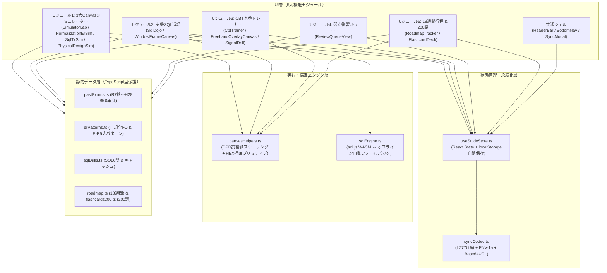
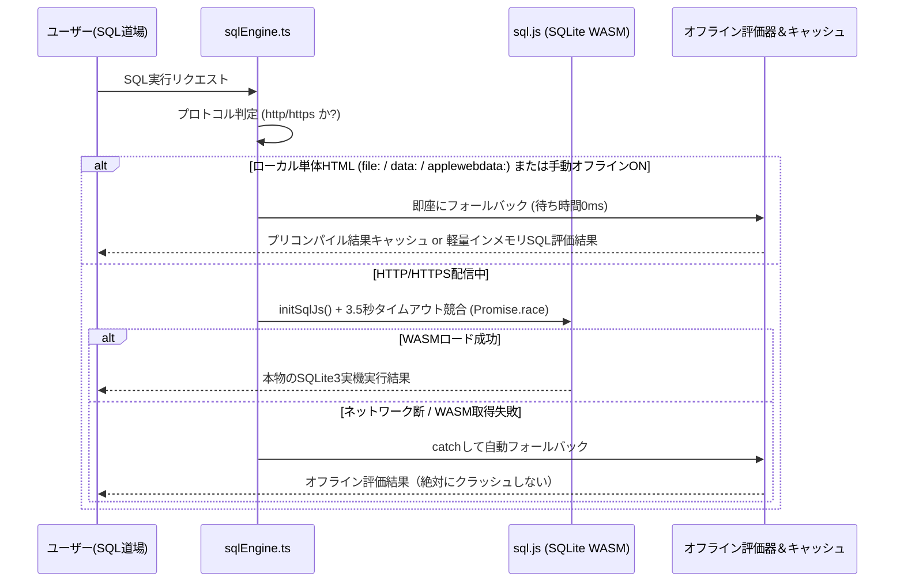
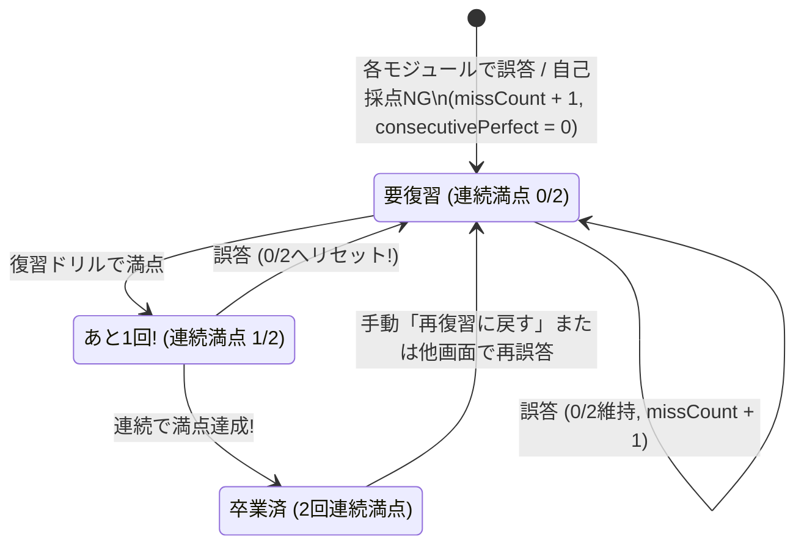

# DB Specialist Bootcamp & Simulator 技術構成解説 ＆ 使用・運用マニュアル

本ドキュメントは、データベーススペシャリスト試験（令和8年度後期・CBT方式）対策Webアプリ **「DB Specialist Bootcamp & Simulator」** の内部アーキテクチャを**エンジニアの学習教材として解説する第1部**と、MacBook・iPhone・iPad mini を跨いで合格まで使い倒すための**実践的な使用・運用マニュアル（第2部）**で構成されています。

---

# 第1部：システム構成解説（エンジニアリング学習編）

## 1. 技術スタックと設計思想

本アプリは「**開発時はモダンなコンポーネント分割で保守しやすく、配布時はたった1つのHTMLファイル（約632KB）としてiPhone/iPadで完全オフライン動作させる**」という相反する要件を両立させるために設計されています。

| レイヤー | 採用技術 | 選定理由・設計意図 |
|---|---|---|
| ビルドツール | Vite 6 + `vite-plugin-singlefile` + カスタム後処理プラグイン | 開発時は高速HMR、本番ビルド時はJS/CSSを1枚のHTMLへインライン化＋iPadOS互換のクラシックIIFE変換を実施 |
| UIフレームワーク | React 19 + TypeScript 5.8 (`strict: true`) | 宣言的UIと厳密な型定義（[exam.ts](file:///Users/kotaro_yoshimura/db-exam-bootcamp/src/types/exam.ts)）により、過去問データ・下線状態・弱点キューの整合性をコンパイル時に保証 |
| スタイリング | Tailwind CSS v4 (`@tailwindcss/vite`) | 使用クラスだけを最小CSSへコンパイルし、単一HTMLのファイルサイズを抑制 |
| 図解・可視化 | HTML5 `<canvas>` 2D API（インラインSVG 0件） | iOS/iPadOSにおけるインラインSVG黒塗りバグを構造的に100%排除し、Apple Pencil対応の透明オーバーレイも統一APIで実現 |
| SQL実行基盤 | `sql.js`（SQLite WASM）＋ 自作オフライン評価器 | ネットワーク配信時は本物のSQLite WASM、オフライン単一HTML起動時はキャッシュ＋軽量インメモリSQL評価器へ無停止フォールバック |
| 状態永続化・同期 | `localStorage` ＋ 自作LZ77圧縮Base64コーデック ＋ JSON入出力 | 外部サーバ・クラウドDBなしで、Appleのユニバーサルクリップボード経由の3秒端末同期と完全バックアップを両立 |

---

## 2. 全体アーキテクチャ図



---

## 3. ディレクトリ構成と役割マップ

- **ビルド・エントリーポイント**
  - [vite.config.ts](file:///Users/kotaro_yoshimura/db-exam-bootcamp/vite.config.ts)：単一HTML化とiPadOS向けクラシック `<script>` 変換プラグイン
  - [index.html](file:///Users/kotaro_yoshimura/db-exam-bootcamp/index.html)：`data:` URL 起動時の `MessageChannel` ガードと QuickLook フォールバック案内
  - [main.tsx](file:///Users/kotaro_yoshimura/db-exam-bootcamp/src/main.tsx)：React 19 `createRoot`（`onUncaughtError` / `AppErrorBoundary` 搭載）
  - [App.tsx](file:///Users/kotaro_yoshimura/db-exam-bootcamp/src/App.tsx)：5大モジュール切替、下部余白 `pb-36` 確保
- **型定義・ユーティリティ・ストア**
  - [exam.ts](file:///Users/kotaro_yoshimura/db-exam-bootcamp/src/types/exam.ts)：アプリ全体のドメインモデル型定義
  - [canvasHelpers.ts](file:///Users/kotaro_yoshimura/db-exam-bootcamp/src/utils/canvasHelpers.ts)：DPRスケーリング・矢印・カーディナリティ・角丸矩形の描画ライブラリ
  - [sqlEngine.ts](file:///Users/kotaro_yoshimura/db-exam-bootcamp/src/utils/sqlEngine.ts)：`sql.js` WASM ＋ オフライン評価フォールバック二段構えエンジン
  - [syncCodec.ts](file:///Users/kotaro_yoshimura/db-exam-bootcamp/src/utils/syncCodec.ts)：LZ77圧縮＋FNV-1aチェックサム＋URLセーフBase64変換＋フォールバックコピー
  - [useStudyStore.ts](file:///Users/kotaro_yoshimura/db-exam-bootcamp/src/state/useStudyStore.ts)：学習状態、2回連続満点卒業ロジック、同期＆ロールバック機能
- **データ層（すべて純粋なTypeScript定数）**
  - [erPatterns.ts](file:///Users/kotaro_yoshimura/db-exam-bootcamp/src/data/erPatterns.ts) / [sqlDrills.ts](file:///Users/kotaro_yoshimura/db-exam-bootcamp/src/data/sqlDrills.ts) / [pastExams.ts](file:///Users/kotaro_yoshimura/db-exam-bootcamp/src/data/pastExams.ts) / [roadmap.ts](file:///Users/kotaro_yoshimura/db-exam-bootcamp/src/data/roadmap.ts) / [flashcards200.ts](file:///Users/kotaro_yoshimura/db-exam-bootcamp/src/data/flashcards200.ts)
- **機能モジュールUI**
  - モジュール1：[SimulatorLab.tsx](file:///Users/kotaro_yoshimura/db-exam-bootcamp/src/components/module1/SimulatorLab.tsx), [NormalizationErSim.tsx](file:///Users/kotaro_yoshimura/db-exam-bootcamp/src/components/module1/NormalizationErSim.tsx), [SqlTxSim.tsx](file:///Users/kotaro_yoshimura/db-exam-bootcamp/src/components/module1/SqlTxSim.tsx), [PhysicalDesignSim.tsx](file:///Users/kotaro_yoshimura/db-exam-bootcamp/src/components/module1/PhysicalDesignSim.tsx)
  - モジュール2：[SqlDojo.tsx](file:///Users/kotaro_yoshimura/db-exam-bootcamp/src/components/module2/SqlDojo.tsx), [WindowFrameCanvas.tsx](file:///Users/kotaro_yoshimura/db-exam-bootcamp/src/components/module2/WindowFrameCanvas.tsx)
  - モジュール3：[CbtTrainer.tsx](file:///Users/kotaro_yoshimura/db-exam-bootcamp/src/components/module3/CbtTrainer.tsx), [FreehandOverlayCanvas.tsx](file:///Users/kotaro_yoshimura/db-exam-bootcamp/src/components/module3/FreehandOverlayCanvas.tsx), [SignalDrill.tsx](file:///Users/kotaro_yoshimura/db-exam-bootcamp/src/components/module3/SignalDrill.tsx)
  - モジュール4：[ReviewQueueView.tsx](file:///Users/kotaro_yoshimura/db-exam-bootcamp/src/components/module4/ReviewQueueView.tsx), [SyncModal.tsx](file:///Users/kotaro_yoshimura/db-exam-bootcamp/src/components/common/SyncModal.tsx)
  - モジュール5：[RoadmapFlashcardsView.tsx](file:///Users/kotaro_yoshimura/db-exam-bootcamp/src/components/module5/RoadmapFlashcardsView.tsx), [RoadmapTracker.tsx](file:///Users/kotaro_yoshimura/db-exam-bootcamp/src/components/module5/RoadmapTracker.tsx), [FlashcardDeck.tsx](file:///Users/kotaro_yoshimura/db-exam-bootcamp/src/components/module5/FlashcardDeck.tsx)

---

## 4. エンジニアリング深掘り：実装した6つの実践パターン

### 技術①：単一HTMLビルド ＆ iPadOS WebKit地雷の突破録（実践デバッグ事例）

今回実際にiPad実機確認で遭遇し解決した **3段階のブラウザ制限と突破手法** は、フロントエンド開発における非常に価値の高い学びです。

| 遭遇した現象 | 根本原因 | 実装した解決策 |
|---|---|---|
| ① iPad「ファイル」アプリで真っ暗 | 1) QuickLook簡易プレビューはOS仕様でJS実行自体を遮断<br>2) Vite標準の `<script type="module" crossorigin>` と動的 `import()`（`import.meta.url`）がローカル環境でブロック | [sqlEngine.ts](file:///Users/kotaro_yoshimura/db-exam-bootcamp/src/utils/sqlEngine.ts) を静的import化して `import.meta` を排除。さらに [vite.config.ts](file:///Users/kotaro_yoshimura/db-exam-bootcamp/vite.config.ts#L13-L45) に Rollup `format: 'iife'`＋`closeBundle` 後処理プラグインを実装し、`<script type="module" crossorigin>` を `</body>` 直前のクラシック `<script>` へ変換 |
| ② iPadショートカット経由の `data:` URL で `Script error.` | `data:text/html` は **opaque origin（null origin）** 扱いとなり、React 19内部スケジューラが使う `MessageChannel` 周りのエラーやクロスオリジン扱いイベントが WebKit で `"Script error."` にマスクされた | [index.html](file:///Users/kotaro_yoshimura/db-exam-bootcamp/index.html#L10-L18) の `<head>` 先頭で `location.protocol === 'data:'` 時のみ `window.MessageChannel = undefined` を設定し、React スケジューラを安全な `setTimeout(..., 0)` モードへ自動誘導 |
| ③ `window.onerror` による画面破壊 | 無害なクロスオリジンイベントやマスク済み `Script error.` を拾った瞬間に `root.innerHTML` を上書きしてアプリ本体を消していた | [main.tsx](file:///Users/kotaro_yoshimura/db-exam-bootcamp/src/main.tsx#L49-L68) で非破壊エラーバナー＋React 19公式の `createRoot(el, { onUncaughtError, onCaughtError })` へ切替 |

> [!TIP]
> **ビルド時の注意点**：`vite-plugin-singlefile` の `generateBundle` より前に別プラグインが `<script>` を書き換えると空の `<script></script>` になる罠があります。今回のように `closeBundle()` フックで書き出し完了後の `dist/index.html` を変換する設計にすると、プラグイン実行順に左右されず確実です。

---

### 技術②：HTML5 `<canvas>` 2D API の高精細描画 ＆ 2層フリーハンドオーバーレイ

Retinaディスプレイ（iPhone/iPad/MacBook）で `<canvas>` がぼやけるのを防ぐため、[canvasHelpers.ts](file:///Users/kotaro_yoshimura/db-exam-bootcamp/src/utils/canvasHelpers.ts#L34-L54) の `setupHiDpiCanvas` で **論理ピクセル（CSSサイズ）** と **物理ピクセル（内部バッファ）** を分離しています。

1. `dpr = Math.min(window.devicePixelRatio || 1, 3)` を取得
2. `canvas.width = logicalWidth * dpr`（物理解像度を拡大）
3. `canvas.style.width = logicalWidth + 'px'`（見た目サイズは論理幅に固定）
4. `ctx.setTransform(dpr, 0, 0, dpr, 0, 0)`（以降の描画コードはすべて論理座標のまま記述可能）

さらに [FreehandOverlayCanvas.tsx](file:///Users/kotaro_yoshimura/db-exam-bootcamp/src/components/module3/FreehandOverlayCanvas.tsx#L285-L320) では **2枚のCanvasを `position: absolute; inset: 0` で重ねる2層構造** を採用しています。
- **下層Canvas**：問題E-R図 または A4手元メモ略記お手本（静的な再描画のみ）
- **上層Canvas**：透明フリーハンド層（`onPointerDown / Move / Up` ＋ `setPointerCapture` ＋ CSS `touch-action: none` により、Apple Pencil・指・マウスのすべてを単一コードで処理しつつ、手書きOFF時は `pointer-events: none` で画面スクロールを妨げません）

---

### 技術③：`sql.js`（SQLite WASM）＋ オフライン自動フォールバック二段構え



---

### 技術④：ゼロ依存 Base64圧縮同期コーデックの内部構造

[syncCodec.ts](file:///Users/kotaro_yoshimura/db-exam-bootcamp/src/utils/syncCodec.ts) は外部ライブラリに一切頼らず、わずか約200行で以下を実現しています。

1. **JSON → UTF-8 `Uint8Array`**（`TextEncoder` で日本語をバイト列化）
2. **LZ77スライディングウィンドウ圧縮**：過去255バイト窓から4〜64バイトの一致列を探し、`[0xFF, distance, length]` の3バイトへ置換。元のサイズより小さくならなければ自動で非圧縮フラグ `r` を選択する適応型設計
3. **FNV-1a 16bitチェックサム**：ペースト時の末尾欠けや1文字破損を確実に検出
4. **出力フォーマット**：`DBBC1:<c|r><4桁HEXチェックサム>:<URLセーフBase64>`
5. **クリップボード二重化**：`navigator.clipboard.writeText` が `file://` や `data:` URL で権限拒否された場合、画面外 `<textarea>` ＋ `document.execCommand('copy')` へ自動フォールバック

---

### 技術⑤：弱点復習キューの状態遷移（2回連続満点卒業マシン）



---

### 技術⑥：保守しやすいデータ駆動アーキテクチャ

UIコンポーネントには問題文や数値のハードコードを持たせず、すべて `src/data/` 配下の型付き配列から駆動しています。
- **新しい過去問年度（例：R8秋）を追加したい場合**：
  1. [exam.ts](file:///Users/kotaro_yoshimura/db-exam-bootcamp/src/types/exam.ts#L6) の `ExamYear` 型に `'R8秋'` を追加
  2. [pastExams.ts](file:///Users/kotaro_yoshimura/db-exam-bootcamp/src/data/pastExams.ts) や [sqlDrills.ts](file:///Users/kotaro_yoshimura/db-exam-bootcamp/src/data/sqlDrills.ts) に1オブジェクト追記して `npm run build` するだけで、CBTトレーナー・シグナル発掘・Gemini添削プロンプト生成・弱点復習キューへ自動連動します。

---

# 第2部：使用・運用方法マニュアル（合格実践ガイド）

## 1. 4つの利用モードと使い分け

| 利用シーン | 起動方法 | SQLエンジン | `localStorage` 自動保存 |
|---|---|---|---|
| **① iPad / iPhone ホーム画面アプリ（PWA・おすすめ）** | `dist/` を無料HTTPS（Cloudflare Pages / Netlify / GitHub Pages等）へ配置 → Safariで1回開いて「共有 → ホーム画面に追加」 | **SQLite WASM 実機稼働（機内モードでもSWキャッシュで動作！）** | **永続保存される（アドレスバーなし全画面）** |
| **② MacBook自宅学習（フル機能）** | ターミナルで `npm run dev` または `npm run preview` → ブラウザで開く | SQLite WASM 実機稼働 | 永続保存される |
| **③ iPad自宅学習（同じWi-Fi）** | MacBookで `npx vite preview --host` → iPad Safariで `http://<MacのIP>:4173/` | SQLite WASM 実機稼働 | 永続保存される |
| **④ iPad / iPhone 単一HTMLオフライン** | iCloud Drive の `dist/index.html` を **iOSショートカット（Base64 → Safari）** 等で起動 | オフライン評価＆キャッシュ自動稼働 | ※ショートカット(`data:` URL)はタブを閉じると消えるため、学習後に**3秒同期**を実行 |

> [!TIP]
> **いちばん快適な「ホーム画面アプリ（PWA）」導入手順（約2分）**
> 1. Macで `npm run build` を実行（[dist](file:///Users/kotaro_yoshimura/db-exam-bootcamp/dist) フォルダ一式が生成されます）
> 2. 無料の静的HTTPSホスティングへ `dist` フォルダをアップロードします（Git不要でドラッグ＆ドロップするだけの **Cloudflare Pages（Direct Upload）** や **Netlify Drop**、または **GitHub Pages** が手軽です）
> 3. iPhone / iPad の **Safari** で発行された `https://...` を1回開きます（裏側で Service Worker がアプリ本体と `sql-wasm.wasm` を自動キャッシュします）
> 4. Safari の **共有ボタン（□に↑）→「ホーム画面に追加」** をタップします
> 5. 以降はホーム画面の **DB** アイコンから、**アドレスバーなしの全画面・完全オフライン・履歴自動保存** で起動できます（更新時は右上の「データ同期」内または画面下の更新通知からワンタップ更新可能）。

> [!WARNING]
> **iPadショートカット（`data:` URL）運用時の超重要ルール**
> Safariの仕様により `data:` URL のタブは閉じると `localStorage` が初期化されます。
> **学習開始時**に「🔄 3秒同期」で前回の同期コードをペースト復元し、**学習終了時**に「Base64圧縮同期コードをワンタップコピー」してメモアプリやMacBookへ貼り付ける運用を習慣化すると、1件も履歴を失いません！

---

## 2. MacBook ⇔ iPad / iPhone 同期ワークフロー

### A. GitHub 非公開Gist による無料自動同期（おすすめ・初回設定のみ）
外部有料サーバーなしで、お使いの GitHub アカウントの **非公開（Secret）Gist** を使って全端末を自動同期できます。
1. 右上の **「データ同期」** → **「GitHub で Gist 専用トークンを発行する ↗」** を開く（`gist` 権限だけ自動チェック済）
2. 画面下部の **「Generate token」** を押し、表示されたトークン（`ghp_...`）をコピーしてアプリの入力欄に貼り付け → **「接続して自動同期を開始する」**
3. 2台目以降の端末でも**同じトークンを貼るだけ**で、既存の非公開Gistを自動検出して繋がります
4. 以降は起動時・画面復帰時・学習2.5秒後に自動同期され、複数端末でオフライン学習した場合も達成済み項目を失わずに自動統合されます（トークンは各端末の `localStorage` のみに保存）

### B. 「3秒同期」手動ワークフロー（アカウント不要・オフライン時）

Appleの**ユニバーサルクリップボード**（同一Apple ID＋Wi-Fi/Bluetooth ON）を使うと、本当に3秒で進捗が移ります。

1. **送る側（例：MacBook）**：画面右上の **「🔄 3秒同期」** → **「📋 Base64圧縮同期コードをワンタップコピー」** をクリック
2. **受け取る側（例：iPad）**：画面右上の **「🔄 3秒同期」** → 入力欄にペースト → **「同期コードから復元する」** をタップ
3. **もし誤って古いコードで上書きしてしまったら**：同じモーダル内の **「同期を元に戻す」** ボタンで1発ロールバック可能です
4. **週1回の安全バックアップ**：毎週日曜日に **「⬇ JSONエクスポート保存」** で iCloud Drive にバックアップファイルを残しておくと万全です

---

## 3. 5大モジュールの実践的な学習手順

### モジュール1：3大HTML5 Canvasシミュレーター統合ラボ（理解を視覚で固める）
- **① 正規化・FDパズル＆下線タップ採点**：
  - `UNF → 1NF → 2NF → 3NF / BCNF` を切り替え、赤い破線（部分従属）と黄色い破線（推移従属）が表分割で消える過程を視覚で暗記します。
  - 下段の属性チップをタップして **実線（主キー）／破線（外部キー）／二重線（主兼外）** を採点。1つでも間違うと自動でモジュール4（弱点復習キュー）へ入ります。
- **② E-R図5大パターン連動ビルダー**：
  - 特に「② サブタイプと冗長属性 `[ ]`」「⑤ トランザクション分割と集約（請求番号FKはNULL許容）」のチェックボックスをON/OFFし、スキーマの下線がどう変化するか確認します。
- **③ SQL・排他・分散TX ＆ 物理設計ラボ**：
  - ウィンドウ関数スライサーは**行#2（10/02同日タイ行）**で `ROWS` と `RANGE` を切り替えるのが最大の学びポイントです。
  - 物理設計ラボでは、低クラスタ索引の抽出率スライダーを `0.1% → 5.0%` に動かし、**わずか数%でフルスキャンに逆転される瞬間**と、4096B容量計算の **`floor`（切捨て）／`ceil`（切上げ）** を体得してください。

### モジュール2：実機SQL道場（手を動かしてSQLの罠を潰す）
- `Ctrl + Enter`（Macは `Cmd + Enter`）で即座に実行・自動採点されます。
- 「オフライン動作テスト」チェックボックスをONにすると、飛行機内やiPadローカル起動時のフォールバック動作を事前に確認できます。
- ページ下部の **「ウィンドウ関数フレーム可視化Canvas」** で「ステップ再生 ▶」を押すと、パーティション境界での集計リセットと直近3行フレームの動きが頭に入ります。

### モジュール3：CBT本番スプリット画面トレーナー（令和8年度後期CBTの最終兵器）
本番と同じ流れで以下の4ステップを1セットとして演習します。
1. **CBT残時間タイマーを「計測開始」**（PC/iPad横向きでは `50-50` / `60-40` 比率を好みに調整）
2. **【特化①】A4メモお手本 ＆ 透明オーバーレイ描画**：左ペインの図表上で「✏ 手書きON」にし、Apple Pencilや指で1対多矢印・複合キー・NULL注意を直接描き込みながら思考整理
3. **【特化②】本文シグナル発掘**：右ペインの「本文シグナル発掘」タブで、「高々1つ」「いずれか一方」「同一日に複数回」など主キー・多重度の決定打となる表現をタップ発掘
4. **記述解答 ＆【特化③】Gemini添削連携**：
   - 字数カウンターを見ながら制限字数以内で記述（入力内容は自動下書き保存）
   - **「📋 Gemini添削用プロンプトをコピー (@db-afternoon-kakomon-review)」** をタップし、そのままGeminiチャットへ貼り付けてプロレベルの添削レビューを受ける
   - 公式解答と比較して不十分だった設問は **「× 不十分 → 弱点復習キューへ登録」** を押す

### モジュール4：弱点復習キュー（試験直前の得点源）
- 間違えた「スキーマ下線」「CBT記述」「本文シグナル」「物理計算」がここに集約されます。
- **「2回連続満点」で卒業**、途中で1回でも間違うと `0/2` にリセットされる厳格ルールにより、まぐれ正解を排除して本物の定着へ導きます。

### モジュール5：18週間ロードマップ ＆ 200語フラッシュカード
- **2026/11/23（Week 1）〜 2027/03/28（Week 18）** の進捗を週次で管理します。各タスク右側の **「開く →」** ボタンから該当モジュールへ直接ジャンプできます。
- **200語フラッシュカード**は通勤・スキマ時間に「重要度A（超頻出）」→「要復習のみ」フィルタで高速周回するのが最も効率的です。

---

## 4. メンテナンス・アップデート運用コマンド集（MacBook側）

アプリのコードや過去問データを改修・追加した後は、以下の手順だけでiPad側へ最新アプリを反映できます。

```bash
# 1. ローカル開発サーバー起動（コード編集中）
npm run dev

# 2. TypeScript型チェック ＋ 単一HTML本番ビルド（dist/index.html を生成）
npm run build

# 3. 自宅Wi-Fi経由でiPad Safariからテスト配信する場合
npx vite preview --host 0.0.0.0 --port 4173
```

**iPadオフライン版の更新手順（10秒）**：
1. MacBookで `npm run build` を実行
2. 生成された [dist/index.html](file:///Users/kotaro_yoshimura/db-exam-bootcamp/dist/index.html) を、iCloud Drive の `ダウンロード/index.html` へ上書きコピー
3. iPadのショートカットをそのまま再生するだけ（ショートカット自体の作り直しは不要）

---

## 5. トラブルシューティング FAQ

| 症状 | 原因と対処法 |
|---|---|
| iPad「ファイル」アプリで直接タップしたら案内文で止まる | ファイルアプリ標準のQuickLookはJSを無効化するため正常な挙動です。作成した **iPadショートカット** または **Documents等のHTML対応アプリ** から開いてください。 |
| iPadで `http://<MacのIP>:4173/` に繋がらない | ①MacとiPadが同じWi-Fiか確認 ②MacのIPが変わっていないか `ipconfig getifaddr en0` で確認 ③Macで `npx vite preview --host 0.0.0.0 --port 4173` が起動中か確認してください。 |
| 同期コードを貼っても「チェックサム不一致」になる | コピー範囲の末尾が欠けている可能性があります。送信側で再度「ワンタップコピー」を押し、全文字ペーストしてください。 |
| SQL道場で「オフライン評価＆キャッシュ稼働中」と出る | `file://` やショートカット（`data:` URL）起動時は仕様通り自動フォールバックしています。全6問の採点・任意 `SELECT` ともそのまま学習可能です。 |
